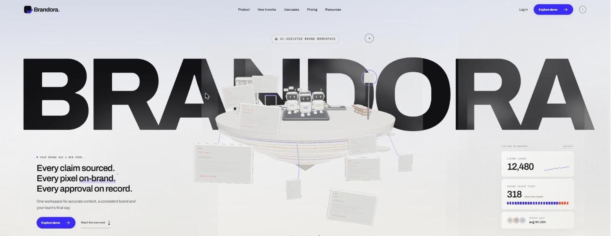

# Brandora — the intelligence layer for brand trust

**Live app:** https://brandora-omega-three.vercel.app · **Code:** https://github.com/DuvvuruDeepakReddy18/brandora · **Evaluator guide:** [JUDGES.md](JUDGES.md)

[](https://github.com/DuvvuruDeepakReddy18/brandora/actions/workflows/ci.yml) [](https://github.com/DuvvuruDeepakReddy18/brandora/actions/workflows/live-check.yml)

**Round 3 report (PDF):** [docs/Brandora_Round3_Final_Report.pdf](docs/Brandora_Round3_Final_Report.pdf) · **Docs:** [Testing & reliability](docs/TESTING.md) · [Privacy, security, accessibility & responsible design](docs/RESPONSIBLE_DESIGN.md) · [Check-before-publish API](docs/API.md) · [Known limitations & roadmap](ROADMAP.md) · [Changelog](CHANGELOG.md)

Marketing teams publish ads with wrong prices, outdated trial periods, unsupported "No. 1" claims and the wrong logo. Brandora checks every ad, image, PDF or piece of copy against the company's **own approved records**, **marks each problem directly on the content** with its evidence, lets a **human reviewer decide**, helps **fix and re-check** it, **approves one exact version**, and keeps a **complete audit trail**. When an approved fact changes later, it finds every piece of content that relied on it.

## New in Round 3

| Commitment | Where to see it | What it shows |
|---|---|---|
| **Measured, trustworthy findings + tone & messaging** | Trust & Audit → **Reliability** | 120 labelled items (40 development and two held-out rounds of 40, 33 clean controls) run through the production engine. Measured, fixed, re-measured: **93.5% precision and 93.5% recall on a fresh held-out round written after the fixes** (round 1 first run: 96.2% / 86.2%; its five failures were fixed in the engine), **79/79 valid citations**, with every remaining miss explained. CI fails if scores drop or [`docs/reliability.json`](docs/reliability.json) is stale. Tone & messaging findings (violet) cite the approved Brand voice guide. |
| **Every format, page by page, with accessibility** | Scan & Detect → *Festive brochure · 10-page PDF* and *Partner sales deck · 6 slides* | PDFs and PowerPoint decks rendered page by page with page navigation, thumbnails with per-page finding counts, and zoom. Accessibility findings (teal) are measured: real text contrast vs WCAG 4.5:1 / 3:1 with the ratio, small text in points, missing or unhelpful alt text. Documents are revised by uploading the corrected file. |
| **From repeated mistakes to clearer guidelines** | Company Hub → **Guideline insights** | Recurring mistakes by rule, channel, campaign and team (never individuals); rules flagged as possibly unclear from reviewer overrides and needs-review volume; a clarified rule replayed on history (predicted vs actual reviewer decisions) and applied only by a different manager, with an audit record. Seeded history is fictional and labelled. |

**Also new in Round 3**

| Addition | Where to see it | What it shows |
|---|---|---|
| **Brand colour palette check** | The sample ad (mark 2), brochure page 6, any upload | Measured colours on images, PDF pages and slides compared with the approved palette in Brand identity guidelines, with swatches and a suggested approved colour. A judgement call, because photography may use other colours |
| **Check-before-publish API** | Trust & Audit → **Integrations** (as Manager) | Create a key and send a test request: `POST /api/v1/check` returns `clear`, `needs_review` or `blocked` with evidence. Rules only, never approves, can submit drafts for review. See [docs/API.md](docs/API.md) |
| **Live claim check, every day** | The *Live claim check* badge above | [`scripts/verify_live.py`](scripts/verify_live.py) walks every documented claim through the production API, as an evaluator would. Latest results: [`docs/live-verification.json`](docs/live-verification.json) |
| **Accessible workspace** | [`docs/accessibility-audit.json`](docs/accessibility-audit.json) | Brandora's own 24 screens audited (WCAG 2.2 AA subset): 23 issues found and fixed, now 0 |

Code: [`backend/evaluation.py`](backend/evaluation.py) and [`backend/eval/dataset.json`](backend/eval/dataset.json) · [`backend/documents.py`](backend/documents.py) (PDF and PowerPoint pages, measured contrast) · tone and accessibility checks in [`backend/engine.py`](backend/engine.py) · [`backend/insights.py`](backend/insights.py) (insights and replay) · screens in [`app/components/round3.tsx`](app/components/round3.tsx).

## Start with the one-minute product story

Open the live app and, before anything else, press **Watch the crew work** under the headline. The landing page then plays itself from top to bottom: the four-robot Brand Crew, the camera flight over the island, the shelf of case files, the ink reveal of each corrected campaign, the asset workflows and the audit trail. It ends on **Explore demo**. Scroll, click or press any key to take over at any point. Prefer to scroll yourself? Just scroll to the end.

Direct link that auto-plays the story: https://brandora-omega-three.vercel.app/brand-crew/index.html?tour=1 (it is also available inside the app as **Watch the product story**).

**Make sure you see the original 3D landing.** It should look like the image below: the BRANDORA wordmark with four robots on a floating island. The landing is drawn live with WebGL (3D graphics in the browser). If your browser has 3D graphics turned off, a notice at the top says *You are seeing a still image of this page*, and the scene is shown as a still image. To see the interactive original, turn on hardware acceleration (Chrome or Edge: Settings → System → *Use graphics acceleration when available*), restart the browser and reload. Check `chrome://gpu` if it still does not start. The product itself (everything after **Explore demo**) does not need WebGL.



## Then try the product in three minutes (no login, no setup)


1. Press **Explore demo** at the end of the story (or in the top bar). You get a private, temporary copy of the fictional company **Inkloom AI**. It opens on an employee-submitted ad with **seven numbered marks**.
2. **Click any mark.** The right panel shows the submitted text next to the approved company record, the exact source excerpt and version, the confidence and the next step. A connector line links the mark to its explanation.
3. **Decide as a reviewer:** switch to *Reviewer* in the demo bar and confirm, reject, request evidence or escalate. Every decision needs a reason and is logged.
4. **Fix and approve:** switch to *Creator* → **Fix & approve** → **Apply all suggestions** → **Save corrected version & re-check** (it comes back clean) → **Request review**. Switch to *Reviewer* → **Approve this exact version**. Open **Original vs corrected** to see both side by side.
5. **Change a fact:** switch to *Manager* → **Impact Monitor** → change the free trial from 14 to 7 days → *Preview impact* → *Publish change*. The old version is kept and every linked item, including approved ones, is flagged for reassessment.
6. **Scan new content:** open **Scan & Detect** and press **Use this sample**. The *Festive offer brochure* (PDF) and *Partner social caption* (text) are checked on the server, and each card says what Brandora should find. Live AI (Gemini) is **on by default** in the demo, so the *Wrong ad* and *Corrected ad* images are read by real OCR and logo comparison, and **Re-read with live AI** works on the sample ad straight away. A manager can turn AI off in **Trust & Audit → Privacy & AI**.

The demo bar explains what the current person can and cannot do, ticks off the six guided steps as you complete them (including a Partner step that shows campaign isolation), offers a **Next** button, and has a **More to explore** row that jumps to every other feature (Company Hub records, importing a sample policy document, resolving a source conflict, tracing a fact, logos and colour checks, team and roles, audit trail, review report, translation). Wherever a role cannot do something, the screen says why and offers a one-click switch to the right person.

## Sample files (download from the demo bar or use them in place)

| File | Use it in | Needs AI | What Brandora should find |
|---|---|---|---|
| `brochure.pdf` | Scan & Detect | No | Wrong Starter price (₹799 vs ₹999), 30-day trial, "fastest" and "10,000+ teams" flagged for review; Professional price verified |
| `social-post.txt` | Scan & Detect | No | Wrong product name "Ink Loom", ₹1,499 and 30 days contradicted, GST note to review, "best tool" flagged |
| `festive-brochure-10-pages.pdf` | Scan & Detect | No | Marks on 9 of 10 pages: wrong Starter price and trial, “Ink Loom”, hype and pressure wording, two low-contrast texts (2.02:1 and 1.76:1) and 6 pt small print |
| `festive-brochure-corrected.pdf` | Fix & approve → *Upload revised file* on the brochure | No | Version 2 of the brochure with every finding fixed in the file: comes back clean |
| `partner-deck.pptx` | Scan & Detect | No | Unsupported ranking claims, a wrong Professional price, a missing and an unhelpful alt text on slide 4, a 2.32:1 subtitle, “game-changing” and too many exclamation marks |
| `creative.png` | Scan & Detect | Yes (on by default) | The seven problems in the sample ad, read by live OCR and logo comparison (live AI may add a blue, citation-checked suggestion) |
| `corrected-creative.png` | Scan & Detect, or *Upload revised creative* in Fix & approve | Yes (on by default) | Approved logo and correct copy; comes back clean with verified values |
| `billing-policy.txt` | Company Hub → Import document | No | Extracted text you check and register as a new approved source |
| `scanned-source.pdf` | Company Hub → Import document (AI OCR) | Yes | The pricing policy transcribed from an image-only PDF |

## What is wrong in the sample ad, and how Brandora classifies it

| # | In the ad | Status | Why |
|---|---|---|---|
| 1 | Orange, stretched logo | **Visual brand violation** (red) | Does not match the approved Inkloom AI logo in Company Hub |
| 2 | "The world's No. 1 creative platform" | **Evidence gap** (orange) | No approved evidence supports the ranking. Unverified, not declared false |
| 3 | "Reduce your marketing production time by 80%" | **Evidence gap** (orange) | No approved study supports the 80% figure |
| 4 | "30-day free trial" | **Confirmed contradiction** (red) | Pricing policy v1: free trial is 14 days |
| 5 | "₹1,499 per month" for Professional | **Confirmed contradiction** (red) | Pricing policy v1: Professional is ₹1,999/month |
| 6 | Price shown without GST note | **Needs human review** (yellow) | Policy says prices exclude GST; a reviewer decides whether this placement must say so |
| 7 | Orange button and peach offer box | **Off-palette colours** (yellow) | Measured colours (ΔE 86 and 20 from the nearest approved colour) are not in the approved palette in Brand identity guidelines; a reviewer decides, because photography may legitimately use other colours |

Colours are consistent everywhere: **red** = confirmed contradiction or visual violation, **orange** = evidence gap, **yellow** = needs human review, **blue** = AI suggestion, **violet** = tone & messaging, **teal** = accessibility, **green** = verified against an approved source. Red is never used just because AI is unsure.

## The six modules

| Module | What it does |
|---|---|
| **01 Company Hub** | The source of truth: pricing and plans, approved claims, brand voice guide, approved colour palette, accessibility standard, policies, evidence library, approved logos, campaigns, team roles. Versioned records with owners and review dates; document import (PDF, DOCX, TXT, scanned PDF via OCR); source-conflict detection; "used in N items" lineage for every fact; **Guideline insights** with clarified-rule replay and approval. |
| **02 Scan & Detect** | Drag-and-drop upload of ads, social creatives, multi-page PDFs, PowerPoint decks and documents, or paste copy. Images are read with OCR and compared with approved logos; PDFs and decks are read from the file page by page; text is compared with Company Hub; contrast, text size and alt text are measured. Findings are marked on each page. Clear processing states; failures are reported, never shown as a successful scan. |
| **03 Verify & Review** | Review queue plus the annotated review workspace: submitted vs approved side by side, source excerpt and version, and reviewer actions (confirm, mark verified, reject, request evidence, escalate, comment). Evidence requests and escalations become owned tasks. |
| **04 Fix & Approve** | Accept, edit or skip each suggested correction (approved values, approved-claim rewrites), save a new version, re-check it, request review and approve. Only an independent reviewer can approve; approval binds to a SHA-256 hash of the exact version and issues a receipt. Approval never publishes anything. |
| **05 Impact Monitor** | Change an approved fact with a dry-run preview first. Publishing creates a new source version, keeps the old one and flags every linked item with priority and owner. Receipts answer "what was approved at the time?" |
| **06 Trust & Audit** | Searchable audit trail (uploads, fact changes, decisions, approvals, rule clarifications, API calls, settings), approval receipts, the measured **Reliability** report, **Integrations** (API keys and a test console), AI and privacy controls, workspace export. |

## How decisions are made, and what Brandora refuses to do

- **Deterministic first.** Prices (including ₹1,999 and lakh formats like ₹1,00,000), plan-specific prices, trial lengths, product names and mapped claims are checked by a rule engine against approved records. Each finding carries the source ID, version and exact excerpt.
- **Evidence gaps are not "false".** A claim with no approved support is marked *Unverified* and must be supported, rewritten or removed. Unmapped superlatives and percentages ("best", "No. 1", "40%") are flagged for human review, never auto-judged.
- **AI assists, people decide.** Gemini reads text from images (OCR), compares logos and suggests wording issues. AI suggestions must cite an approved excerpt exactly or they are rejected; AI confidence is never treated as proof.
- **No silent success.** If OCR or the AI provider fails, nothing is saved and the screen says so, offering manual review instead.
- **Demo vs real is labelled.** In the sample ad, text findings come from the live rule engine; the text positions and the logo finding are predefined sample data and are labelled as such. **Re-read with live AI** analyses the same image for real. Uploaded content is always analysed dynamically.
- **Brandora does not edit images.** Corrections to a creative are shown as a text-and-layout draft with the approved logo, clearly labelled. To approve the visual itself, upload the revised creative and it is re-checked.
- **Approval is human and exact.** Authors and last editors cannot approve their own work; any edit or source change invalidates the approval and requires a re-check.

## Real organisations

- One-time owner setup (secret code), then the manager creates accounts with roles: **manager** (Company Hub, settings), **creator** (drafts and uploads), **reviewer** (decisions and approval), **partner** (only assigned campaigns).
- Every query is scoped to the organisation on the server; partners are restricted to assigned campaigns by the API, not just hidden in the UI.
- Uploaded creatives are stored privately with their content version for review and audit; deleting content removes them while keeping receipt hashes and audit metadata.
- Limits: 3 MB uploads; images up to 8 megapixels; 30 AI requests per workspace per day (30 per demo session). If a daily limit or the provider stops the AI part of a check, the rule checks still complete and the result is marked *AI incomplete* with a **Retry check** button; approval waits for a complete check or for a manager to turn AI off.

## Architecture

- **Frontend:** Next.js 16, React 19, TypeScript. The public landing page ("The Brand Crew") is unchanged; the workspace uses the same theme.
- **Backend:** FastAPI with validated request models, server-side access checks and transactional persistence. PostgreSQL (Neon) in production, SQLite locally.
- **AI:** Gemini 3.5 Flash-Lite for OCR, logo comparison, semantic suggestions and translation, called only from the server with structured, validated outputs and a 55-second deadline. If it is busy or out of free quota, Gemini 3.1 Flash Lite (also free) answers instead, and each result names the model that produced it. Anthropic is supported for text-only features.
- **Deployment:** Vercel Services (Next.js + FastAPI) with sensitive environment variables.
- Key files: rule engine `backend/engine.py`, API `backend/main.py`, demo company `backend/demo.py`, review workspace `app/components/review-workspace.tsx`, modules `app/components/modules.tsx`.

## Verify it yourself

```powershell
npm ci
python -m venv .venv-app
.\.venv-app\Scripts\python.exe -m pip install -r backend/requirements-lock.txt
.\.venv-app\Scripts\python.exe -m pytest backend/tests -q
npm run typecheck
npm run build
```

94 backend tests cover the Round 3 work (the colour palette check and its evidence gate, the check-before-publish API with keys, verdicts, refusals and draft submission, judgement calls carried only when the wording is unchanged, the reliability thresholds and that the published report is current, tone checks and their channel scoping, the 10-page brochure and deck with page-specific findings and measured ratios, PDF and PowerPoint uploads without AI, alt text as part of the reviewed version, revising a document by uploading the corrected file, insights that group by team and never name people, and the propose → replay → approve flow including self-approval and stale-replay refusals) as well as: the sample files scanning without AI, the seven sample findings and their evidence, Indian-format and plan-specific prices, typographic quotes, corrections clearing findings, reviewer-decision rules (authors cannot decide, contradictions cannot be dismissed), visual violations, dynamic creative scanning with a mocked provider, provider failure saving nothing, a busy AI provider retried twice with backoff and then answered by the free backup model (with configuration errors never switching models and results labelled with the model that answered), organisation isolation, self-approval prevention, stale scans, source-change invalidation and demo sandbox limits. Tests never call an external model.

Run locally: `.\Start-Brandora.ps1`, then open http://127.0.0.1:3200 and choose **Explore demo**. Set `GEMINI_API_KEY` in the API process to enable AI features (see `.env.example`).

## Honest limits

The full list, with a realistic roadmap, is in [ROADMAP.md](ROADMAP.md). In short:


- OCR can misread text; logo comparison is visual similarity, not proof of authenticity; text positions on images are estimated within each OCR line.
- Brandora does not track who saw published content, so it reports "previously approved" content as high priority rather than inventing exposure numbers.
- No email notifications or automatic publishing; account recovery is administrator-operated.
- Functional and provider verification only; no penetration test or load certification.

AI assistance disclosure: Codex and Claude Code assisted planning, implementation, testing and deployment. Dependencies are declared in the lockfiles. Details of the earlier release are in [DEPLOYMENT.md](DEPLOYMENT.md) and [VERIFICATION.md](VERIFICATION.md).
