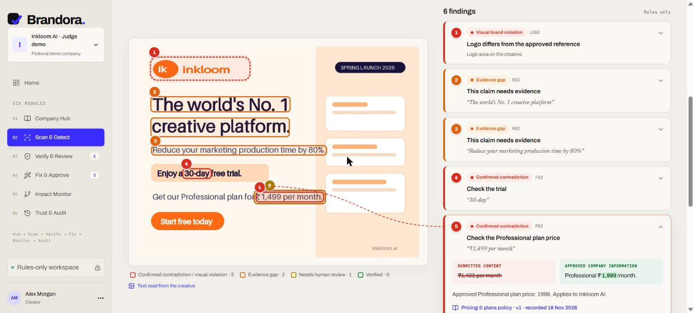

# Brandora — the intelligence layer for brand trust

**Live app:** https://brandora-omega-three.vercel.app · **Code:** https://github.com/DuvvuruDeepakReddy18/brandora · **Evaluator guide:** [JUDGES.md](JUDGES.md)

Marketing teams publish ads with wrong prices, outdated trial periods, unsupported "No. 1" claims and the wrong logo. Brandora checks every ad, image, PDF or piece of copy against the company's **own approved records**, **marks each problem directly on the content** with its evidence, lets a **human reviewer decide**, helps **fix and re-check** it, **approves one exact version**, and keeps a **complete audit trail**. When an approved fact changes later, it finds every piece of content that relied on it.



## Try it in three minutes (no login, no setup)

1. Open the live app and choose **Explore demo**. You get a private, temporary copy of the fictional company **Inkloom AI**. It opens on an employee-submitted ad with **six numbered marks**.
2. **Click any mark.** The right panel shows the submitted text next to the approved company record, the exact source excerpt and version, the confidence and the next step. A connector line links the mark to its explanation.
3. **Decide as a reviewer:** switch to *Reviewer* in the demo bar and confirm, reject, request evidence or escalate. Every decision needs a reason and is logged.
4. **Fix and approve:** switch to *Creator* → **Fix & approve** → **Apply all suggestions** → **Save corrected version & re-check** (it comes back clean) → **Request review**. Switch to *Reviewer* → **Approve this exact version**. Open **Original vs corrected** to see both side by side.
5. **Change a fact:** switch to *Manager* → **Impact Monitor** → change the free trial from 14 to 7 days → *Preview impact* → *Publish change*. The old version is kept and every linked item, including approved ones, is flagged for reassessment.
6. **Try your own content:** as Manager, enable AI in **Trust & Audit → Privacy & AI**, then upload the sample ad (download link in the demo bar) or any creative in **Scan & Detect**. Those findings come from live OCR and logo comparison, not sample data.

## What is wrong in the sample ad, and how Brandora classifies it

| # | In the ad | Status | Why |
|---|---|---|---|
| 1 | Orange, stretched logo | **Visual brand violation** (red) | Does not match the approved Inkloom AI logo in Company Hub |
| 2 | "The world's No. 1 creative platform" | **Evidence gap** (orange) | No approved evidence supports the ranking. Unverified, not declared false |
| 3 | "Reduce your marketing production time by 80%" | **Evidence gap** (orange) | No approved study supports the 80% figure |
| 4 | "30-day free trial" | **Confirmed contradiction** (red) | Pricing policy v1: free trial is 14 days |
| 5 | "₹1,499 per month" for Professional | **Confirmed contradiction** (red) | Pricing policy v1: Professional is ₹1,999/month |
| 6 | Price shown without GST note | **Needs human review** (yellow) | Policy says prices exclude GST; a reviewer decides whether this placement must say so |

Colours are consistent everywhere: **red** = confirmed contradiction or visual violation, **orange** = evidence gap, **yellow** = needs human review, **blue** = AI suggestion, **green** = verified against an approved source. Red is never used just because AI is unsure.

## The six modules

| Module | What it does |
|---|---|
| **01 Company Hub** | The source of truth: pricing and plans, approved claims, policies, evidence library, approved logos, campaigns, team roles. Versioned records with owners and review dates; document import (PDF, DOCX, TXT, scanned PDF via OCR); source-conflict detection; "used in N items" lineage for every fact. |
| **02 Scan & Detect** | Drag-and-drop upload of ads, social creatives, brochures and documents, or paste copy. Images are read with OCR and compared with approved logos; text is compared with Company Hub. Findings are marked on the content with page/image coordinates. Clear processing states; failures are reported, never shown as a successful scan. |
| **03 Verify & Review** | Review queue plus the annotated review workspace: submitted vs approved side by side, source excerpt and version, and reviewer actions (confirm, mark verified, reject, request evidence, escalate, comment). Evidence requests and escalations become owned tasks. |
| **04 Fix & Approve** | Accept, edit or skip each suggested correction (approved values, approved-claim rewrites), save a new version, re-check it, request review and approve. Only an independent reviewer can approve; approval binds to a SHA-256 hash of the exact version and issues a receipt. Approval never publishes anything. |
| **05 Impact Monitor** | Change an approved fact with a dry-run preview first. Publishing creates a new source version, keeps the old one and flags every linked item with priority and owner. Receipts answer "what was approved at the time?" |
| **06 Trust & Audit** | Searchable audit trail (uploads, fact changes, decisions, approvals, settings), approval receipts, AI and privacy controls, workspace export. |

## How decisions are made, and what Brandora refuses to do

- **Deterministic first.** Prices (including ₹1,999 and lakh formats like ₹1,00,000), plan-specific prices, trial lengths, product names and mapped claims are checked by a rule engine against approved records. Each finding carries the source ID, version and exact excerpt.
- **Evidence gaps are not "false".** A claim with no approved support is marked *Unverified* and must be supported, rewritten or removed. Unmapped superlatives and percentages ("best", "No. 1", "40%") are flagged for human review, never auto-judged.
- **AI assists, people decide.** Gemini reads text from images (OCR), compares logos and suggests wording issues. AI suggestions must cite an approved excerpt exactly or they are rejected; AI confidence is never treated as proof.
- **No silent success.** If OCR or the AI provider fails, nothing is saved and the screen says so, offering manual review instead.
- **Demo vs real is labelled.** In the sample ad, text findings come from the live rule engine; the text positions and the logo finding are predefined sample data and are labelled as such. **Re-read with live AI** analyses the same image for real. Uploaded content is always analysed dynamically.
- **Brandora does not edit images.** Corrections to a creative are shown as a text-and-layout draft with the approved logo, clearly labelled. To approve the visual itself, upload the revised creative and it is re-checked.
- **Approval is human and exact.** Authors and last editors cannot approve their own work; any edit or source change invalidates the approval and requires a re-check.

## Real organisations

- One-time owner setup (secret code), then the manager creates accounts with roles: **manager** (Company Hub, settings), **creator** (drafts and uploads), **reviewer** (decisions and approval), **partner** (only assigned campaigns).
- Every query is scoped to the organisation on the server; partners are restricted to assigned campaigns by the API, not just hidden in the UI.
- Uploaded creatives are stored privately with their content version for review and audit; deleting content removes them while keeping receipt hashes and audit metadata.
- Limits: 3 MB uploads; images up to 8 megapixels; 30 AI requests per workspace per day (12 per demo session).

## Architecture

- **Frontend:** Next.js 16, React 19, TypeScript. The public landing page ("The Brand Crew") is unchanged; the workspace uses the same theme.
- **Backend:** FastAPI with validated request models, server-side access checks and transactional persistence. PostgreSQL (Neon) in production, SQLite locally.
- **AI:** Gemini 3.5 Flash-Lite for OCR, logo comparison, semantic suggestions and translation, called only from the server with structured, validated outputs and a 55-second deadline. Anthropic is supported for text-only features.
- **Deployment:** Vercel Services (Next.js + FastAPI) with sensitive environment variables.
- Key files: rule engine `backend/engine.py`, API `backend/main.py`, demo company `backend/demo.py`, review workspace `app/components/review-workspace.tsx`, modules `app/components/modules.tsx`.

## Verify it yourself

```powershell
npm ci
python -m venv .venv-app
.\.venv-app\Scripts\python.exe -m pip install -r backend/requirements-lock.txt
.\.venv-app\Scripts\python.exe -m pytest backend/tests -q
npm run typecheck
npm run build
```

62 backend tests cover: the six sample findings and their evidence, Indian-format and plan-specific prices, typographic quotes, corrections clearing findings, reviewer-decision rules (authors cannot decide, contradictions cannot be dismissed), visual violations, dynamic creative scanning with a mocked provider, provider failure saving nothing, organisation isolation, self-approval prevention, stale scans, source-change invalidation and demo sandbox limits. Tests never call an external model.

Run locally: `.\Start-Brandora.ps1`, then open http://127.0.0.1:3200 and choose **Explore demo**. Set `GEMINI_API_KEY` in the API process to enable AI features (see `.env.example`).

## Honest limits

- OCR can misread text; logo comparison is visual similarity, not proof of authenticity; text positions on images are estimated within each OCR line.
- Brandora does not track who saw published content, so it reports "previously approved" content as high priority rather than inventing exposure numbers.
- No email notifications or automatic publishing; account recovery is administrator-operated.
- Functional and provider verification only; no penetration test or load certification.

AI assistance disclosure: Codex and Claude Code assisted planning, implementation, testing and deployment. Dependencies are declared in the lockfiles. Details of the earlier release are in [DEPLOYMENT.md](DEPLOYMENT.md) and [VERIFICATION.md](VERIFICATION.md).
